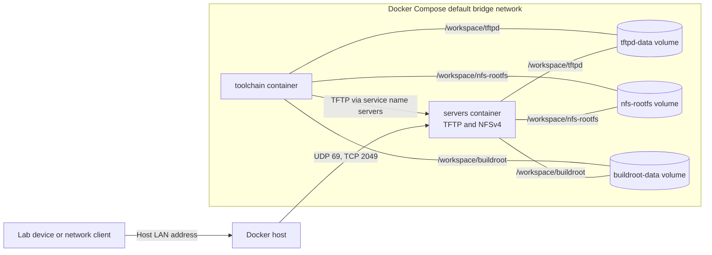

Public resources for the course "MA Secure Embedded Systems"

This is the contents needed for the various labs:

```
labs/
├── .devcontainer
│   ├── devcontainer.json
│   ├── docker-compose.yml
│   ├── docker-compose.build.yml
│   ├── buildroot
│   │   └── devcontainer.json
│   └── servers
│       └── devcontainer.json
└── resources
    └── utilities
        ├── nfs_rootfs.sh
        └── sd_copy.sh
```

To open the full `labs` workspace in VS Code, open the `labs` folder and run **Dev Containers: Reopen in Container** from the Command Palette. VS Code first builds both images using `docker-compose.build.yml`, then starts both services from `docker-compose.yml` and attaches to the selected service (`toolchain` by default). Both services share `/workspace` and the named Buildroot, TFTP, and NFS volumes.

## Network topology



The `labs` folder is bind-mounted at `/workspace` in both containers. The named volumes overlay `/workspace/buildroot`, `/workspace/tftpd`, and `/workspace/nfs-rootfs`, so files written to those paths in `toolchain` are immediately visible to `servers`. Docker publishes TFTP on UDP 69 and NFSv4 on TCP 2049. Use the Docker host's LAN address for another machine; from `toolchain`, use the Compose service name `servers`. TFTP is served by dnsmasq in single-port mode, so the whole transfer stays on UDP 69; this is required because Docker Desktop's port proxy drops replies sent from any other port.

## Serving files

### TFTP

Copy files from `toolchain` into `/workspace/tftpd`; this directory is the TFTP root. For example:

```sh
cp /workspace/buildroot/output/images/<file> /workspace/tftpd/
```

Clients download by filename relative to that root. For example, with curl:

```sh
curl -o <local-file> tftp://<server-address>/<file>
```

Use `servers` as `<server-address>` from `toolchain`, or the Docker host's LAN address from a lab device. On a Windows host, the lab device can only reach the server after the [Windows host setup](#windows-host-setup) below.

### NFS

Copy files from `toolchain` into `/workspace/nfs-rootfs`. This shared volume is exported by NFSv4 at pseudo-path `/`. From a Linux client, mount it with:

```sh
sudo mkdir -p /mnt/nfs-rootfs
sudo mount -t nfs4 -o vers=4.1 <server-address>:/ /mnt/nfs-rootfs
```

The Ganesha configuration grants read/write access to `192.168.1.2`, the Docker bridge range `172.16.0.0/12`, `127.0.0.1`, and `::1`. The Docker range is needed because, with Docker Desktop, every connection to the published port arrives from the Docker bridge gateway rather than from the real client. Ganesha therefore cannot tell clients apart, so on Windows the [Windows host setup](#windows-host-setup) firewall rule is what restricts access to the lab device. To change the list, edit `Clients` in `.devcontainer/servers/ctxt/ganesha.conf`, then rebuild/reopen the Dev Container so the updated config is copied into the server image. NFS uses `No_Root_Squash`, so only grant access to trusted clients.

Only NFSv4 over TCP 2049 is served (no rpcbind/mountd), so clients must request `vers=4.x`.

### Booting the target with an NFS root filesystem

The default `raspberrypi4_64_defconfig` kernel already contains everything needed for an NFS root (`CONFIG_ROOT_NFS`, NFSv4.1, `CONFIG_IP_PNP` and the built-in Ethernet driver). The kernel is still loaded from the SD card; only the root filesystem comes from the server.

1. In Buildroot, enable **Filesystem images > tar the root filesystem** (`BR2_TARGET_ROOTFS_TAR=y`), for example with `make menuconfig`, then run `make`. This produces `output/images/rootfs.tar` next to `sdcard.img`.
2. From the `toolchain` container, unpack it into the NFS export:

   ```sh
   bash /workspace/resources/utilities/nfs_rootfs.sh
   ```

   The helper replaces the contents of `/workspace/nfs-rootfs` as root (preserving ownership, permissions, and device nodes) and prints the matching kernel command line. Override `SERVER_IP` (default `192.168.1.10`, the PC's address on the lab link), `CLIENT_IP` (default `192.168.1.2`), or `NETMASK` if your addresses differ, for example `SERVER_IP=192.168.1.20 bash ...`.
3. Flash `sdcard.img` as described in [Copying an image to the host](#copying-an-image-to-the-host). Then open the SD card's boot partition on the PC and replace the contents of `cmdline.txt` with the printed line. It must stay a single line:

   ```
   root=/dev/nfs nfsroot=192.168.1.10:/,vers=4.1,proto=tcp rw ip=192.168.1.2:192.168.1.10::255.255.255.0::eth0:off console=tty1 console=ttyAMA0,115200
   ```

   `ip=` configures `eth0` statically in the kernel, before the root filesystem is mounted. Buildroot's `/etc/network/nfs_check` then skips DHCP on `eth0` during boot, so the NFS connection is not interrupted.
4. Boot the target and watch the serial console (115200 baud). After a successful boot, `mount` on the target shows `192.168.1.10:/ on / type nfs4`.

If the boot hangs at `VFS: Unable to mount root fs via NFS`, check that the firewall rule for TCP 2049 exists and that `servers` is running. The server logs to `/var/log/ganesha/ganesha.log` inside the container. Just after `servers` starts, Ganesha is in a 90-second grace period, which can delay the first boot.

## Windows host setup

On Windows, Docker Desktop relays published ports through its own proxy, so the containers see every client as the Docker gateway and cannot filter by client IP themselves. Windows Defender Firewall must do it instead. The steps below assume the lab device is `192.168.1.2` and is connected directly to an Ethernet port of the PC; adjust the address if yours differs.

### 1. Mark the lab Ethernet connection as Private

Windows assigns each network a profile (Public or Private), and firewall rules apply per profile. The rules in step 3 are created for the Private profile only, so they do not open anything on public Wi-Fi.

Using Settings:

1. Connect the lab device and power it on, so that the Ethernet link is up.
2. Open **Settings > Network & internet > Ethernet** and select the adapter the lab device is plugged into.
3. Under **Network profile type**, choose **Private network**.

Or using an Administrator PowerShell:

```powershell
# Find the adapter the lab device is connected to (it has the 192.168.1.x address)
Get-NetConnectionProfile
Get-NetIPAddress -AddressFamily IPv4 | Where-Object IPAddress -like '192.168.1.*'

# Mark it Private (replace "Ethernet 3" with your InterfaceAlias)
Set-NetConnectionProfile -InterfaceAlias "Ethernet 3" -NetworkCategory Private
```

Windows remembers the choice for that network. A direct cable link without a gateway may show up as **Unidentified network** and fall back to Public every time it reconnects. If that happens, open `secpol.msc` (not available on Windows Home) and go to **Network List Manager Policies > Unidentified Networks**. Set **Location type** to **Private** there. This applies to every unidentified network, so only do it on a machine where that is acceptable.

### 2. Make sure the Private firewall profile is enabled

```powershell
Get-NetFirewallProfile | Format-Table Name, Enabled
Set-NetFirewallProfile -Profile Private -Enabled True
```

With the profile enabled, inbound traffic is blocked unless a rule allows it.

### 3. Allow only the lab device

Run in an Administrator PowerShell:

```powershell
$backend = "C:\Program Files\Docker\Docker\resources\com.docker.backend.exe"
New-NetFirewallRule -DisplayName "Labs TFTP from RPi" -Direction Inbound -Action Allow -Protocol UDP -LocalPort 69   -RemoteAddress 192.168.1.2 -Program $backend -Profile Private
New-NetFirewallRule -DisplayName "Labs NFS from RPi"  -Direction Inbound -Action Allow -Protocol TCP -LocalPort 2049 -RemoteAddress 192.168.1.2 -Program $backend -Profile Private
```

Docker Desktop installs its own "Docker Desktop Backend" rules that allow all ports on Public networks. That is another reason to keep the lab connection Private, and to be aware that the published ports are reachable from a Public network such as Wi-Fi.

## Copying an image to the host

After Buildroot has generated `/workspace/buildroot/output/images/sdcard.img`, run the provided helper from the `toolchain` container:

```sh
bash /workspace/resources/utilities/sd_copy.sh
ls -lh /workspace/sd_dir/sdcard.img
```

The helper creates `/workspace/sd_dir` and copies the image there. Because `/workspace` is the host's `labs` folder, the image is then available on the host at `labs/sd_dir/sdcard.img` (in this checkout: `C:\Users\isc\workspace\code\ma_ses\resources\labs\sd_dir\sdcard.img`).

Use Raspberry Pi Imager or balenaEtcher on the host, choose **Use custom image** (or the equivalent), select `sdcard.img`, choose the SD card, and start writing. This is a raw disk image, so do not copy it onto an already-mounted SD-card partition. Verify the selected device carefully; flashing erases its contents.

The helper expects the generated image at `/workspace/buildroot/output/images/sdcard.img` and writes to `/workspace/sd_dir`. If you change either location, update `resources/utilities/sd_copy.sh` accordingly.